# HARSH KUMAWAT

### Software Engineer · Full-Stack Developer · AI & Systems Enthusiast

Building reliable applications, exploring intelligent systems, and turning ideas into working software.

[LinkedIn](https://linkedin.com/in/harsh-kumawat-829b7b32a) · [Email](mailto:harshk94138167777@gmail.com) · Udaipur, India

---

## About Me

I'm a Computer Science and Engineering student and aspiring Software Engineer who enjoys building full-stack applications, solving engineering problems, and exploring modern AI technologies.

- **Currently focused on:** Full-stack engineering, Agentic AI, and system design.
- **Languages:** Python, C++, JavaScript, C.
- **Backend:** Node.js, Express.js, REST APIs.
- **Frontend:** React.js, Vite, Tailwind CSS.
- **Data & infrastructure:** MongoDB, MySQL, Redis, Docker, Linux.
- **Engineering foundations:** DSA, OOP, DBMS, Operating Systems, Computer Networks.

## The Skill Universe

I'm the sun at the center, and each planet orbiting me is a skill area.

**🟠 Programming**  
   

**🔵 Frontend**  
  

**🟢 Backend & APIs**  
  

**🪐 Databases**  
  

**🟣 AI & LLMs**  
  

**🔴 Tools & Platforms**  
   

**🌐 Computer Science**  
DSA · OOP · DBMS · Operating Systems · Computer Networks · System Design

## Featured Projects

Click **View repository →** to open each project.

### 01 · SUpp — Real-Time Chat Application

**Secure real-time communication**  
<a href="https://github.com/HarshKumawat-7/SUpp">View repository →</a>

     

- React + Vite frontend styled with Tailwind CSS.
- Node.js and Express backend with JWT authentication, protected routes, and profile management.
- Socket.io enables real-time messaging across online users.
- Cloudinary supports image and media uploads.
- Modular controllers and global client-side stores manage authentication, chat, and theme state.

### 02 · tEStro — Cybersecurity Testing Lab

**SOC-style dashboard with modular security simulations**  
<a href="https://github.com/HarshKumawat-7/tEStro">View repository →</a>

   

- Simulations cover injection, XSS, authentication, brute-force login attempts, traffic load, API probes, headers, file/path checks, and safe DoS scenarios.
- Recharts dashboards with JSON/PDF report exports.
- MongoDB stores testing history.
- Includes Helmet, scoped rate limits, localhost-only live HTTP, and capped concurrency safeguards.
- A premium ML module for heuristic risk scoring and larger-scale simulations is in development.

### 03 · DOCQ — AI Document Intelligence

**Document-aware AI conversations**  
<a href="https://github.com/HarshKumawat-7/DOCQ">View repository →</a>

     

- React/Vite SaaS dashboard with Node.js/Express APIs.
- Retrieval-Augmented Generation (RAG) pipeline using MongoDB vector search.
- Streaming LLM responses (OpenAI/Gemini) delivered through Server-Sent Events (SSE).
- Role-Based Access Control (RBAC) and JWT authentication.
- Background PDF/DOCX processing with BullMQ and Redis.

---

### Let's build something meaningful.

**Open to learning, collaboration, and opportunities in software engineering and AI.**

[Connect on LinkedIn](https://linkedin.com/in/harsh-kumawat-829b7b32a) · [Send an Email](mailto:harshk94138167777@gmail.com)

